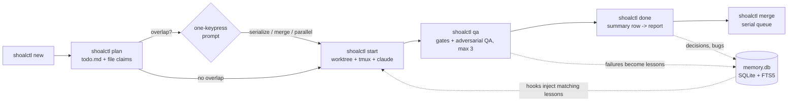

<div align="center">

<picture>
  <source media="(prefers-color-scheme: dark)" srcset="docs/images/readme/logo-dark.svg">
  
</picture>

**Run many Claude Code sessions on one repo without collisions, and remember why the code is the way it is.**

[](https://github.com/kennethsolomon/shoalctl/blob/main/LICENSE)
[](https://github.com/kennethsolomon/shoalctl)
[](https://go.dev/)
[](#roadmap)
[](#status)

</div>

---

## Status

> **Pre-alpha, not yet released.** The Phase 0 MVP is built: `init`, `new`, `start`, `status`, `done`, and a minimal `doctor` that checks the hook entries. Everything else (`plan`, `qa`, `merge`, `recall`, `why`, and the rest) is **planned**; each feature and command below is marked, and the [Roadmap](#roadmap) gives the phase. [`docs/spec.md`](docs/spec.md) is the full design. Screenshots are mockups.

## What is shoal

A shoal is many fish moving together without colliding. shoal is a small CLI that does the same for AI coding sessions. The command is `shoalctl`.

You give it tasks. It gives each task its own branch, git worktree, and tmux window, then launches Claude Code inside it. It checks which files each task plans to touch and asks you before two tasks overlap. It merges finished work one task at a time. And it keeps a per-project SQLite memory of the *why*: root causes, decisions, conventions, and lessons, each tied to a commit SHA and file paths.

### Why

Running two or three Claude Code sessions on one repo goes wrong in predictable ways:

- Two sessions edit the same file and you find out at merge time.
- A bug comes back three weeks later and nobody remembers the root cause.
- Every session starts cold, or starts with a giant CLAUDE.md that burns tokens on rules unrelated to the file at hand.

shoal is glue over tools you already have (git, tmux, Claude Code hooks and subagents) plus one SQLite file. No server, no web UI, no daemon.

## Features

Each item says whether it is built (in the MVP) or planned. See [Roadmap](#roadmap) for the phase.

- **One task, one worktree, one tmux window** (built). Parallel work stays isolated.
- **Baseline test run at start** (built). Every task records which tests passed before it touched anything; `done` reruns the suite and reports regressions (informational in the MVP; a blocking merge gate is planned).
- **Overlap check at planning time** (planned). Each task claims file globs. Collisions trigger a one-keypress prompt: serialize, merge, or run in parallel anyway.
- **Serial merge queue** (planned). Rebase, run gates, fast-forward, mark overlapping tasks for rebase. Never pushes.
- **Three lanes: feature, bugfix, hotfix** (built). The task brief gives the agent its lane's rules: a test for every new behaviour (feature), a failing reproduction test committed before the fix (bugfix), and the same with the smallest possible diff (hotfix). QA capped at 3 rounds, then escalated to you (planned).
- **File-scoped memory** (planned). Hooks inject only the lessons and decisions that match the file being touched, once per session. Session-start brief stays under ~1k tokens.
- **`shoalctl why`** (planned). Stored root cause plus live `git log`, so a regression points at the commit that undid the fix.
- **Stealth by default** (built). Nothing committed to the repo. Good for client work.
- **Any stack** (built). Your test, lint, and build commands live in config.

## Screenshots

> Mockups of the intended design. `status` and the task report exist in the MVP with plainer output; the overlap prompt and `shoalctl why` are planned.

| | |
|---|---|
|  |  |
| *Mockup, design preview: `shoalctl status`* | *Mockup, design preview: one-keypress overlap prompt* |
|  |  |
| *Mockup, design preview: task report* | *Mockup, design preview: `shoalctl why` regression lookup* |

## Quick start

Install from source (there are no releases yet):

```sh
go install github.com/kennethsolomon/shoalctl/cmd/shoalctl@latest   # needs Go 1.27+
# Homebrew tap and release binaries: planned (Phase 5)
```

The MVP flow (these commands are built):

```sh
cd your-repo
shoalctl init           # register the project, wire hooks (stealth, nothing committed); prints the config path
                        # edit that config: set [tests].command, or format = "none" if there are no tests
shoalctl new bugfix "Users page shows wrong display name"   # prints the slug, e.g. 1-users-page-shows-wrong-display-name
shoalctl start 1        # branch + worktree + baseline test run + tmux window + claude
shoalctl status         # board of tasks
# when the agent says it is finished, exit claude in its window (/exit), then:
shoalctl done 1         # final test run, informational regression check, report
shoalctl doctor         # check the hook entries; doctor --fix repairs them after you move the binary
```

Planned, not built yet: `shoalctl plan <task>` (file claims and the overlap check, Phase 2) and `shoalctl merge` (the serial merge queue, Phase 1). Until then you review and merge the task branch yourself.

Requirements: macOS or Linux, git 2.31+, tmux 3.2+, and Claude Code (`claude` on `PATH`, trusted once in the main checkout: run `claude` there and choose *Yes, I trust this folder*).

## How it works



The diagram is the full design. In the MVP the path is `new` → `start` → `done`, and you merge the branch yourself.

- Sessions never talk to each other. They coordinate through one SQLite file in WAL mode.
- Claude Code hooks call the shoalctl binary (the MVP registers `SessionStart` and `Stop` as silent heartbeats; the injecting `PreToolUse` and `PostToolUse` handlers are planned), which is why it's written in Go: hooks fire on every file touch, so startup time matters. A hook-shaped call (open the DB, run one FTS5 query) measured about 8-12 ms, against about 40-65 ms for Python just to import `sqlite3` ([Phase 0 results](docs/phase-0-results.md)).
- Everything shoal stores lives in `~/.shoal/projects/<id>/`, where `<id>` is a hash of the git remote URL (falling back to the repo path).

## Installing into an existing project

shoal never rewrites your `CLAUDE.md`.

- **Stealth (default):** `CLAUDE.md` is untouched. Context comes in through hooks registered in `.claude/settings.local.json`, which shoal adds to `.git/info/exclude` (never your committed `.gitignore`).
- **Managed block (opt-in, planned for Phase 4):** shoal adds one marked block containing a single import line pointing at `~/.shoal/projects/<id>/context.md`. Claude Code asks once to approve the external import.

  ```
  <!-- shoal:begin -->
  @~/.shoal/projects/<id>/context.md
  <!-- shoal:end -->
  ```

- **Your rules win** (planned, with conventions in Phase 4). When a proposed convention contradicts an existing rule, shoal flags it for discussion instead of overriding it.
- **Hooks are merged.** shoal adds its two entries to `.claude/settings.local.json` and leaves every other byte of the file as it was; your own hooks stay. `shoalctl uninstall` (planned) removes only shoal's entries and block.
- **Hooks fail open.** A shoal hook never blocks or breaks a Claude session. Handlers exit 0 within 2 seconds, print nothing, and log failures to `~/.shoal/logs/hooks.log`; `shoalctl status` warns when that log has new lines. The registered command also maps any exit status to 0 (`... || true`), so even a crash or a moved binary cannot block a session. Hooks that fail open fail silently, so after moving the binary run `shoalctl doctor`, and `shoalctl doctor --fix` to re-point the hooks.

Details in [spec section 5](docs/spec.md#5-installing-into-a-project-that-already-has-a-claudemd).

## Configuration

Stealth projects keep config in `~/.shoal/projects/<id>/config.toml`. Teams that want shared config can opt in to a committed `.shoal.toml` (`shoalctl init --commit-config`). Unknown keys are an error, so typos surface. A full example (a test keeps it valid against the loader):

```toml
[tests]
command = "php artisan test --log-junit {junit}"   # {junit}: the file shoal reads results from
format  = "junit"                                   # junit | go-json | exit-code | none
timeout = "30m"

[stack]
name  = "laravel"
lint  = "vendor/bin/pint --test"   # run by done, informational
build = "npm run build"

[session]
model = "claude-opus-5-5"

[merge]
base = "main"

[hotfix]
production_ref = "production"      # branch, tag, or "tag:<glob>"

[reports]
sink = "local"        # local | notes | both
notes_path = ""       # absolute path to your notes folder, only if sink includes notes

[privacy]
deny_globs = [".env*"]
```

## Commands

| Command | What it does | Status |
|---------|--------------|--------|
| `shoalctl init` | Register the project and wire hooks (stealth by default) | Built |
| `shoalctl new <feature\|bugfix\|hotfix> "<title>"` | Create a task | Built |
| `shoalctl start <task> [--model <m>]` | Branch + worktree + baseline test run + tmux window + `claude` | Built |
| `shoalctl status [--json]` | Board of all tasks | Built |
| `shoalctl done <task> [--force]` | Final test run, regression check (informational), summary and report | Built |
| `shoalctl doctor [--fix]` | Check, and repair, shoal's hook entries (the full doctor is Phase 2) | Built (minimal) |
| `shoalctl brief` | Print the session-start brief (also run by the `SessionStart` hook) | Planned (Phase 3) |
| `shoalctl plan <task>` | Write `todo.md` and file claims, run the overlap check | Planned (Phase 2) |
| `shoalctl qa <task>` | Gates plus adversarial QA round (max 3) | Planned (Phase 1) |
| `shoalctl merge` | Process the merge queue one task at a time | Planned (Phase 1) |
| `shoalctl recall <query>` | Full-text search over decisions, lessons, bugs, conventions | Planned (Phase 3) |
| `shoalctl why <file\|sha\|bug>` | Stored WHY plus live `git log` | Planned (Phase 3) |
| `shoalctl convention propose\|agree\|retire` | Manage conventions | Planned (Phase 4) |
| `shoalctl gc` | Clean up merged worktrees and windows | Planned (Phase 5) |
| `shoalctl export` / `shoalctl purge` | Offboard a project's data | Planned (Phase 5) |
| `shoalctl uninstall` | Remove shoal's hooks and CLAUDE.md block only | Planned (Phase 5) |

## Memory & privacy

- **Code over record.** Every stored record has the SHA it was true at. Injected records say so and tell the agent to verify against current code. If the code disagrees, the code wins and the record is flagged stale.
- **No git copy.** Diffs, authors, and commit messages are read live from git, never stored.
- **No transcripts.** Only structured summaries.
- **Stays local.** `memory.db`, reports, and worktrees live in `~/.shoal/`, never in the repo. No telemetry, no network calls of shoal's own.
- **Secrets skipped.** `.env*` and your `deny_globs` are never indexed or injected.

## Roadmap

| Phase | Scope | Status |
|-------|-------|--------|
| Design | Spec, README, mockups | **Done** |
| 0: MVP | `init`, `new`, `start`, `status`, `done`, minimal hook-only `doctor`, baseline test run, report render | **Built** (not yet released) |
| 1: Agent team + merge gate | `shoal-*` agents, messages, contracts, QA loop, scope matrix, hotfix backport, zero-regression merge gate, serialized `merge` | Planned |
| 2: Claims + queue | Cross-task file claims, overlap prompt, per-target merge queue, full `doctor` | Planned |
| 3: Memory + hooks | Lessons, decisions, bugs, FTS5, injecting hooks, `why`, `recall` | Planned |
| 4: Conventions | Convention lifecycle, lesson promotion, managed CLAUDE.md block | Planned |
| 5: Publish | `export`/`purge`/`uninstall`, releases, Homebrew tap | Planned |

## Contributing

shoal is pre-alpha. [Issues](https://github.com/kennethsolomon/shoalctl/issues) and discussion on the [spec](docs/spec.md) are welcome. Code contributions will open once the first release is tagged.

## License

[MIT](LICENSE) © 2026 Kenneth Solomon

## Acknowledgements

- [octogent](https://github.com/hesamsheikh/octogent) (MIT) for the two ideas shoal borrows: scoped context per job, and `todo.md` as the task list. shoal is a separate project, not a fork.
- Built on git worktrees, tmux, and Claude Code hooks and subagents.
