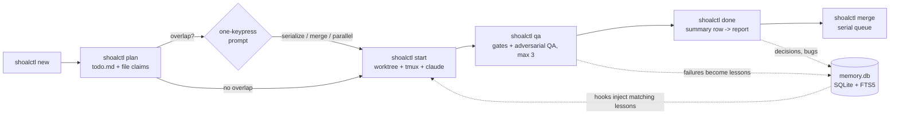

<div align="center">

<picture>
  <source media="(prefers-color-scheme: dark)" srcset="docs/images/readme/logo-dark.svg">
  
</picture>

**Run many Claude Code sessions on one repo without collisions, and remember why the code is the way it is.**

[](https://github.com/kennethsolomon/shoalctl/blob/main/LICENSE)
[](https://github.com/kennethsolomon/shoalctl)
[](https://go.dev/)
[](https://github.com/kennethsolomon/shoalctl/actions/workflows/ci.yml)
[](#status)

</div>

---

## Status

> **Pre-alpha, not yet released.** Phases 0 and 1 are built: `init`, `new`, `start`, `status`, `done`, a minimal `doctor`, the `shoal-*` agent team (`agents`, `msg`, `contract`, `claim`/`release`), the QA loop (`qa`), the scope matrix (`scope`), red/green proofs (`repro`), the `test` command, and the zero-regression `merge` gate. Everything else (`plan`, `recall`, `why`, injecting hooks, and the rest) is **planned**; each feature and command below is marked, and the [Roadmap](#roadmap) gives the phase. [`docs/spec.md`](docs/spec.md) is the full design. Screenshots are mockups.

## What is shoal

A shoal is many fish moving together without colliding. shoal is a small CLI that does the same for AI coding sessions. The command is `shoalctl`.

You give it tasks. It gives each task its own branch, git worktree, and tmux window, then launches Claude Code inside it. It checks which files each task plans to touch and asks you before two tasks overlap. It merges finished work one task at a time. And it keeps a per-project SQLite memory of the *why*: root causes, decisions, conventions, and lessons, each tied to a commit SHA and file paths.

### Why

Running two or three Claude Code sessions on one repo goes wrong in predictable ways:

- Two sessions edit the same file and you find out at merge time.
- A bug comes back three weeks later and nobody remembers the root cause.
- Every session starts cold, or starts with a giant CLAUDE.md that burns tokens on rules unrelated to the file at hand.

shoal is glue over tools you already have (git, tmux, Claude Code hooks and subagents) plus one SQLite file. No server, no web UI, no daemon.

## Features

Each item says whether it is built or planned. See [Roadmap](#roadmap) for the phase.

- **One task, one worktree, one tmux window** (built). Parallel work stays isolated.
- **Baseline test run at start** (built). Every task records which tests passed before it touched anything. Flaky tests are re-run (`[tests].flaky_retries`); a test flaky at baseline is quarantined and listed in every report.
- **Zero-regression merge gate** (built). `shoalctl merge` takes done tasks oldest first, one at a time: rebase onto the target, baseline at the new base, full suite, lint and build. A test that passed before and fails, disappears, gets skipped or turns flaky blocks the merge (exit 9), as does a coverage drop on a changed file when coverage is configured. The only override is `--task <task> --accept-regression <test> --reason "<why>"`: an acceptance always names the one task it covers, needs a human at a terminal (an agent is refused, exit 5), and is recorded in the report. A task an interrupted merge left at `merging` is settled by the next `merge`. Never pushes.
- **Agent team per task** (built). Eight `shoal-*` Claude Code agent definitions (lead, backend, frontend, integration, docs, three QA roles), per-agent file claims inside a task, messages in the store, and a frozen API contract the QA round checks.
- **Scope you ask for is enforced** (built). "Also test X" becomes a case matrix (happy, boundary, invalid, empty, permission, concurrency, failure, ui-state); `done` refuses until every row is green or a human waives it.
- **Overlap check at planning time** (planned). Each task claims file globs. Collisions trigger a one-keypress prompt: serialize, merge, or run in parallel anyway.
- **Three lanes: feature, bugfix, hotfix** (built). Features list each new behaviour and need a new passing test for it; bugfixes and hotfixes need a recorded red-then-green regression test (`repro`); hotfixes branch from production, keep to a line budget, merge back into the production branch, and leave a backport task. QA is capped at 3 rounds, then the task escalates to you.
- **File-scoped memory** (planned). Hooks inject only the lessons and decisions that match the file being touched, once per session. Session-start brief stays under ~1k tokens.
- **`shoalctl why`** (planned). Stored root cause plus live `git log`, so a regression points at the commit that undid the fix.
- **Stealth by default** (built). Nothing committed to the repo. Good for client work.
- **Any stack** (built). Your test, lint, and build commands live in config.

## Screenshots

> Mockups of the intended design. `status` and the task report exist with plainer output; the overlap prompt and `shoalctl why` are planned.

| | |
|---|---|
|  |  |
| *Mockup, design preview: `shoalctl status`* | *Mockup, design preview: one-keypress overlap prompt* |
|  |  |
| *Mockup, design preview: task report* | *Mockup, design preview: `shoalctl why` regression lookup* |

## Quick start

Install from source (there are no releases yet):

```sh
go install github.com/kennethsolomon/shoalctl/cmd/shoalctl@latest   # needs Go 1.27+
# Homebrew tap and release binaries: planned (Phase 5)
```

The flow (these commands are built):

```sh
cd your-repo
shoalctl init           # register the project, wire hooks (stealth, nothing committed); prints the config path
                        # edit that config: set [tests].command, or format = "none" if there are no tests
shoalctl new bugfix "Users page shows wrong display name"   # prints the slug, e.g. 1-users-page-shows-wrong-display-name
shoalctl start 1        # branch + worktree + baseline test run + tmux window + claude
shoalctl status         # board of tasks
# when the agent says it is finished, exit claude in its window (/exit), then:
shoalctl qa 1           # one QA round: contract, suite vs baseline, lint, build (3 rounds max, then escalated)
shoalctl done 1         # final run; refuses without a red/green proof, with open scope rows, or over the hotfix budget
shoalctl merge          # gate + fast-forward of every done task, oldest first; never pushes
shoalctl doctor         # check the hook entries; doctor --fix repairs them after you move the binary
```

Once per machine, `shoalctl agents install` puts the `shoal-*` agent definitions in `~/.claude/agents/` (or the repo's `.claude/agents/` with `--commit`). Planned, not built yet: `shoalctl plan <task>` (cross-task file claims and the overlap check, Phase 2).

Requirements: macOS or Linux, git 2.31+, tmux 3.2+, and Claude Code (`claude` on `PATH`, trusted once in the main checkout: run `claude` there and choose *Yes, I trust this folder*).

Platform support:

| Platform | Status |
|----------|--------|
| macOS | Primary, supported |
| Linux | Supported, CI-tested |
| Windows | **Beta**: compiles and CI-tested (non-blocking job), far less exercised |

Known Windows limits:
- The full flow needs tmux, which Windows has no native build of; CI on Windows runs only the tests that need no tmux or POSIX shell, and a Windows CI failure does not block `main`.
- The suite job-object and process start-time identity code is newer than its unix counterpart.
- If shoalctl is hard-killed between starting a suite and attaching it to its job object, the suite can stay suspended and must be killed by hand (Task Manager or `taskkill /PID <pid>`).

## How it works



The diagram is the full design. Built today: `new` → `start` → `qa` → `done` → `merge`; `plan` and the cross-task claims arrive in Phase 2.

- Sessions never talk to each other. They coordinate through one SQLite file in WAL mode.
- Claude Code hooks call the shoalctl binary (today shoal registers `SessionStart` and `Stop` as silent heartbeats; the injecting `PreToolUse` and `PostToolUse` handlers are planned), which is why it's written in Go: hooks fire on every file touch, so startup time matters. A hook-shaped call (open the DB, run one FTS5 query) measured about 8-12 ms, against about 40-65 ms for Python just to import `sqlite3` ([Phase 0 results](docs/phase-0-results.md)).
- Everything shoal stores lives in `~/.shoal/projects/<id>/`, where `<id>` is a hash of the git remote URL (falling back to the repo path).

## Installing into an existing project

shoal never rewrites your `CLAUDE.md`.

- **Stealth (default):** `CLAUDE.md` is untouched. Context comes in through hooks registered in `.claude/settings.local.json`, which shoal adds to `.git/info/exclude` (never your committed `.gitignore`).
- **Managed block (opt-in, planned for Phase 4):** shoal adds one marked block containing a single import line pointing at `~/.shoal/projects/<id>/context.md`. Claude Code asks once to approve the external import.

  ```
  <!-- shoal:begin -->
  @~/.shoal/projects/<id>/context.md
  <!-- shoal:end -->
  ```

- **Your rules win** (planned, with conventions in Phase 4). When a proposed convention contradicts an existing rule, shoal flags it for discussion instead of overriding it.
- **Hooks are merged.** shoal adds its two entries to `.claude/settings.local.json` and leaves every other byte of the file as it was; your own hooks stay. `shoalctl uninstall` (planned) removes only shoal's entries and block.
- **init refuses before changing anything** when `.claude/settings.local.json` is tracked by git, when it or the `.claude` directory is a symlink (the target may be tracked), or when the committed `.claude/settings.json` already registers shoalctl hooks. The error says how to fix it.
- **Hooks fail open.** A shoal hook never blocks or breaks a Claude session. The whole hook process, logging included, finishes within 2 seconds, prints nothing, and logs failures to `~/.shoal/logs/hooks.log`; `shoalctl status` warns when that log has new lines. The binary path is quoted for the shell that runs it (bash on macOS/Linux, PowerShell on Windows), and the command maps any exit status to 0 (`|| true`, `; exit 0`), so a crash or a moved binary cannot block a session. Because failures are silent, run `shoalctl doctor` after moving the binary, and `shoalctl doctor --fix` to re-point stale hook paths.

Details in [spec section 5](docs/spec.md#5-installing-into-a-project-that-already-has-a-claudemd).

## Running tasks safely

- **One shoalctl per task.** `start` and `done` hold a per-task lock; a second one exits 8 (busy).
- **The suite waits for its pid.** A test run is held until its pid is recorded, so an interrupted shoalctl never leaves an untracked suite.
- **Ctrl-C, SIGTERM, SIGHUP** (terminal closed) stop the suite's whole process group, record the run `cancelled`, and exit 130. Rerun the same command to resume.
- **Leftover runs.** If an earlier shoalctl exited while its run was marked running, `start` and `done` check that pid. Dead, or reused by another process: the run is marked `error` and work continues. Otherwise they exit 8:
  - still running (pid and start time match): stop it with `kill -TERM -- -<pid>`, then retry;
  - unconfirmed (start time missing or unreadable): check it first with `pgrep -l -g <pid>`, stop it only if it is the suite;
  - no recorded pid: make sure no test command of the task is running, then clear the run with the `UPDATE test_runs ...` statement the error prints.
- **`done` refuses (exit 10) while the agent may still be working**: the task's claude window is still live (exit claude, or `--force` once the agent has finished), a git `index.lock` stays held (`--force` does not skip this), or HEAD or the worktree changed during the final run.

## Configuration

Stealth projects keep config in `~/.shoal/projects/<id>/config.toml`. Teams that want shared config can opt in to a committed `.shoal.toml` (`shoalctl init --commit-config`). Unknown keys are an error, so typos surface. A full example (a test keeps it valid against the loader):

```toml
[tests]
command = "php artisan test --log-junit {junit}"   # {junit}: the file shoal reads results from
format  = "junit"                                   # junit | go-json | exit-code | none
rerun_command = "php artisan test --log-junit {junit} --filter {tests}"  # optional; {tests}: ids to re-run
flaky_retries = 2                                   # re-runs of failing tests before a failure counts
timeout = "30m"
coverage_format = ""                                # "" (off) | lcov | cobertura | go-cover
coverage_path = ""                                  # report path relative to the worktree

[stack]
name  = "laravel"
lint  = "vendor/bin/pint --test"   # qa and merge block on a failure; done reports it
build = "npm run build"

[lanes]
qa_max_rounds = 3

[session]
model = "claude-opus-5-5"

[merge]
base = "main"

[hotfix]
production_ref = "production"      # branch, tag, or "tag:<glob>"
backport = true                    # done creates a backport task to [merge].base
max_diff_lines = 100               # added + removed lines outside test files

[reports]
sink = "local"        # local | notes | both
notes_path = ""       # absolute path to your notes folder, only if sink includes notes

[privacy]
deny_globs = [".env*"]
```

`[tests].junit_path` (default `{junit}`, a file shoal owns) tells shoal where the JUnit report lands. If your runner writes its own path, set it to a path or glob relative to the task worktree. shoal deletes stale matches before each run, so it is strict:

- It must end in `.xml`, stay inside the worktree (no `..`, `~`, or absolute paths), and not reach into `.git`. Dotfiles and dot directories below the pattern's fixed part are ignored.
- Every match is checked before any is deleted; one that is a symlink, is not a regular file, resolves outside the worktree, or is tracked by git refuses the whole run.

## Commands

| Command | What it does | Status |
|---------|--------------|--------|
| `shoalctl init` | Register the project and wire hooks (stealth by default) | Built |
| `shoalctl new <feature\|bugfix\|hotfix> "<title>"` | Create a task | Built |
| `shoalctl start <task> [--model <m>]` | Branch + worktree + baseline test run + tmux window + `claude` | Built |
| `shoalctl status [--json]` | Board of all tasks | Built |
| `shoalctl done <task> [--force] [--accept-large-diff --reason "<r>"]` | Final test run, proof/scope/contract/budget checks, summary and report; a hotfix creates its backport task | Built |
| `shoalctl qa <task>` | One QA round: contract hash, suite vs baseline, lint, build. 3 rounds, then escalated | Built |
| `shoalctl merge [--task <task> [--accept-regression <t> --reason "<r>"]...]` | Merge done tasks oldest first through the gate, under `merge.lock` (only `<task>` with `--task`, which `--accept-regression` requires); never pushes | Built |
| `shoalctl test <task> [--kind gate\|qa\|baseline]` | Run the suite in the worktree (a baseline: in a clean scratch worktree at the base commit) and compare with the baseline | Built |
| `shoalctl test quarantine list\|release <test>` | Show or release quarantined flaky tests | Built |
| `shoalctl repro red\|green <task> --test <id>` | Record the red, then green, run of a regression test (bugfix, hotfix) | Built |
| `shoalctl scope add\|case\|show\|review\|check <task> ...` | Scope items, the case matrix, human waivers and manual checks | Built |
| `shoalctl agents install [--commit]` / `agents list` | Install the `shoal-*` agent definitions | Built |
| `shoalctl contract freeze <task>` | Freeze `contract.md`; later changes need a new version and a note | Built |
| `shoalctl claim` / `release <task> --as <agent> <glob>...` | Per-agent file claims inside one task | Built |
| `shoalctl msg send\|inbox <task> ...` | Messages between the agents of one task | Built |
| `shoalctl doctor [--fix]` | Check, and repair, shoal's hook entries (the full doctor is Phase 2) | Built (minimal) |
| `shoalctl brief` | Print the session-start brief (also run by the `SessionStart` hook) | Planned (Phase 3) |
| `shoalctl plan <task>` | Write `todo.md` and file claims, run the overlap check | Planned (Phase 2) |
| `shoalctl recall <query>` | Full-text search over decisions, lessons, bugs, conventions | Planned (Phase 3) |
| `shoalctl why <file\|sha\|bug>` | Stored WHY plus live `git log` | Planned (Phase 3) |
| `shoalctl convention propose\|agree\|retire` | Manage conventions | Planned (Phase 4) |
| `shoalctl gc` | Clean up merged worktrees and windows | Planned (Phase 5) |
| `shoalctl export` / `shoalctl purge` | Offboard a project's data | Planned (Phase 5) |
| `shoalctl uninstall` | Remove shoal's hooks and CLAUDE.md block only | Planned (Phase 5) |

## Exit codes

| Code | Meaning |
|------|---------|
| 0 | Success |
| 1 | Internal error |
| 2 | Usage error |
| 3 | Config error (not a git repo, invalid config, unsafe settings file, DB newer than the binary) |
| 4 | Not found (unknown task) |
| 5 | Invalid state (wrong stage, uncommitted changes, no commits) |
| 6 | Baseline could not be recorded |
| 7 | Missing dependency (`git`, `tmux`, `claude`) |
| 8 | Busy (lock held, or an earlier run may still be alive) |
| 9 | Gate blocked: a regression at `merge`, `qa` or `test`, a failed `repro`, or a rebase conflict |
| 10 | `done` refused (no red/green proof, open scope rows, changed contract, hotfix over budget) |
| 11 | `doctor` found problems it did not fix |
| 12 | Claude Code has not trusted the main checkout |
| 130 | Interrupted (SIGINT, SIGTERM, SIGHUP); a running suite was stopped and recorded `cancelled` |

## Memory & privacy

- **Code over record.** Every stored record has the SHA it was true at. Injected records say so and tell the agent to verify against current code. If the code disagrees, the code wins and the record is flagged stale.
- **No git copy.** Diffs, authors, and commit messages are read live from git, never stored.
- **No transcripts.** Only structured summaries.
- **Stays local.** `memory.db`, reports, and worktrees live in `~/.shoal/`, never in the repo. No telemetry, no network calls of shoal's own.
- **Secrets skipped.** `.env*` and your `deny_globs` are never indexed or injected.

## Roadmap

| Phase | Scope | Status |
|-------|-------|--------|
| Design | Spec, README, mockups | **Done** |
| 0: MVP | `init`, `new`, `start`, `status`, `done`, minimal hook-only `doctor`, baseline test run, report render | **Built** (not yet released) |
| 1: Agent team + merge gate | `shoal-*` agents, messages, contracts, QA loop, scope matrix, hotfix backport, zero-regression merge gate, serialized `merge` | **Built** (not yet released) |
| 2: Claims + queue | Cross-task file claims, overlap prompt, per-target merge queue, full `doctor` | Planned |
| 3: Memory + hooks | Lessons, decisions, bugs, FTS5, injecting hooks, `why`, `recall` | Planned |
| 4: Conventions | Convention lifecycle, lesson promotion, managed CLAUDE.md block | Planned |
| 5: Publish | `export`/`purge`/`uninstall`, releases, Homebrew tap | Planned |

## Contributing

shoal is pre-alpha. [Issues](https://github.com/kennethsolomon/shoalctl/issues) and discussion on the [spec](docs/spec.md) are welcome. Code contributions will open once the first release is tagged.

## License

[MIT](LICENSE) © 2026 Kenneth Solomon

## Acknowledgements

- [octogent](https://github.com/hesamsheikh/octogent) (MIT) for the two ideas shoal borrows: scoped context per job, and `todo.md` as the task list. shoal is a separate project, not a fork.
- Built on git worktrees, tmux, and Claude Code hooks and subagents.
