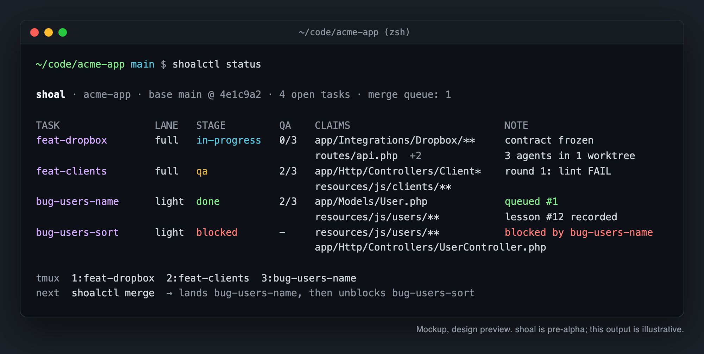
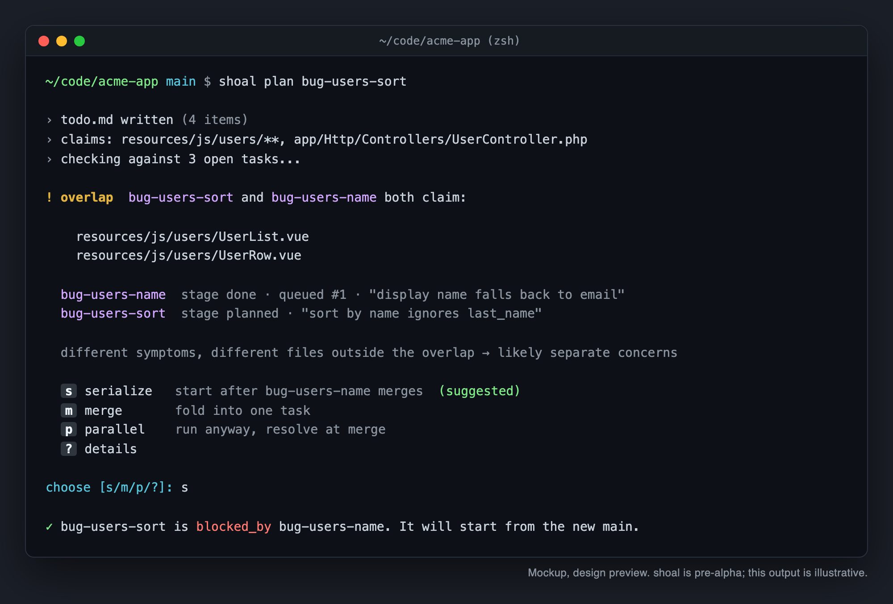
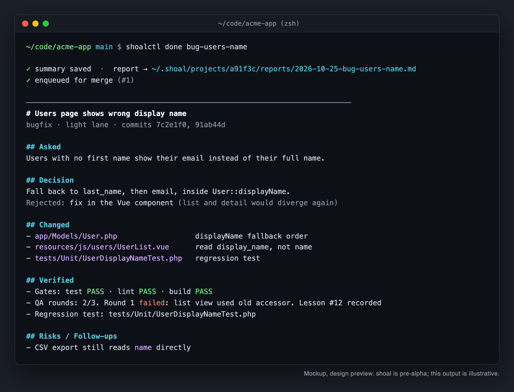
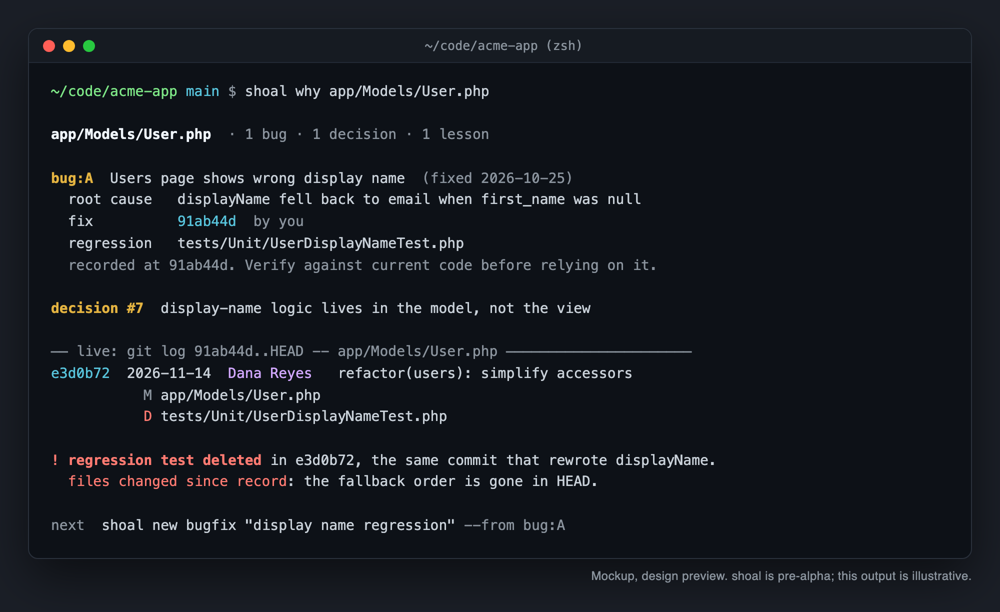
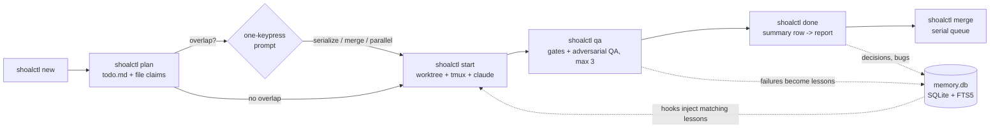

<div align="center">

<picture>
  <source media="(prefers-color-scheme: dark)" srcset="docs/images/readme/logo-dark.svg">
  
</picture>

**Run many Claude Code sessions on one repo without collisions, and remember why the code is the way it is.**

[](https://github.com/kennethsolomon/shoalctl/blob/main/LICENSE)
[](https://github.com/kennethsolomon/shoalctl)
[](https://go.dev/)
[](#roadmap)
[](#status)

</div>

---

## Status

> **Pre-alpha, not yet released.** Only the Phase 0 MVP commands (`init`, `new`, `start`, `status`, `done`) exist so far. This README and [`docs/spec.md`](docs/spec.md) describe what shoal is being built to do. Screenshots are mockups. Everything below is **planned** unless the [Roadmap](#roadmap) says otherwise.

## What is shoal

A shoal is many fish moving together without colliding. shoal is a small CLI that does the same for AI coding sessions. The command is `shoalctl`.

You give it tasks. It gives each task its own branch, git worktree, and tmux window, then launches Claude Code inside it. It checks which files each task plans to touch and asks you before two tasks overlap. It merges finished work one task at a time. And it keeps a per-project SQLite memory of the *why*: root causes, decisions, conventions, and lessons, each tied to a commit SHA and file paths.

### Why

Running two or three Claude Code sessions on one repo goes wrong in predictable ways:

- Two sessions edit the same file and you find out at merge time.
- A bug comes back three weeks later and nobody remembers the root cause.
- Every session starts cold, or starts with a giant CLAUDE.md that burns tokens on rules unrelated to the file at hand.

shoal is glue over tools you already have (git, tmux, Claude Code hooks and subagents) plus one SQLite file. No server, no web UI, no daemon.

## Features

All planned. See [Roadmap](#roadmap) for phase.

- **One task, one worktree, one tmux window.** Parallel work stays isolated.
- **Overlap check at planning time.** Each task claims file globs. Collisions trigger a one-keypress prompt: serialize, merge, or run in parallel anyway.
- **Serial merge queue.** Rebase, run gates, fast-forward, mark overlapping tasks for rebase. Never pushes.
- **Two lanes.** Full lane for features (spec, contract, parallel subagents, docs, QA). Light lane for bugs (trace, fix, regression test, QA). QA capped at 3 rounds, then escalates to you.
- **File-scoped memory.** Hooks inject only the lessons and decisions that match the file being touched, once per session. Session-start brief stays under ~1k tokens.
- **`shoalctl why`.** Stored root cause plus live `git log`, so a regression points at the commit that undid the fix.
- **Stealth by default.** Nothing committed to the repo. Good for client work.
- **Any stack.** Your test, lint, and build commands live in config.

## Screenshots

> Mockup, design preview. The CLI does not exist yet; these show the intended output.

| | |
|---|---|
|  |  |
| *Mockup, design preview: `shoalctl status`* | *Mockup, design preview: one-keypress overlap prompt* |
|  |  |
| *Mockup, design preview: task report* | *Mockup, design preview: `shoalctl why` regression lookup* |

## Quick start

> Planned. These commands do not work yet.

Install (once releases exist):

```sh
brew install kennethsolomon/tap/shoalctl                       # Homebrew tap (planned)
# or
go install github.com/kennethsolomon/shoalctl/cmd/shoalctl@latest
# or download a binary from GitHub Releases
# or build from source
git clone https://github.com/kennethsolomon/shoalctl.git
```

Five commands:

```sh
cd your-repo
shoalctl init                                  # register the project, wire hooks (stealth, nothing committed)
shoalctl new bugfix "Users page shows wrong display name"
shoalctl plan bug-users-name                   # agent writes todo.md + file claims, overlap check runs
shoalctl start bug-users-name                  # branch + worktree + tmux window + claude
shoalctl done bug-users-name && shoalctl merge    # write the report, merge through the queue
```

Requirements (planned): git, tmux, Claude Code.

## How it works



- Sessions never talk to each other. They coordinate through one SQLite file in WAL mode.
- Claude Code hooks (`SessionStart`, `PreToolUse`, `PostToolUse`, `Stop`) call the shoalctl binary, which is why it's written in Go: hooks fire on every file touch, so startup time matters. A hook-shaped call (open the DB, run one FTS5 query) measured about 8-12 ms, against about 40-65 ms for Python just to import `sqlite3` ([Phase 0 results](docs/phase-0-results.md)).
- Everything shoal stores lives in `~/.shoal/projects/<id>/`, where `<id>` is a hash of the git remote URL (falling back to the repo path).

## Installing into an existing project

shoal never rewrites your `CLAUDE.md`.

- **Stealth (default):** `CLAUDE.md` is untouched. Context comes in through hooks registered in `.claude/settings.local.json`, which shoal adds to `.git/info/exclude` (never your committed `.gitignore`).
- **Managed block (opt-in):** shoal adds one marked block containing a single import line pointing at `~/.shoal/projects/<id>/context.md`. Claude Code asks once to approve the external import.

  ```
  <!-- shoal:begin -->
  @~/.shoal/projects/<id>/context.md
  <!-- shoal:end -->
  ```

- **Your rules win.** When a proposed convention contradicts an existing rule, shoal flags it for discussion instead of overriding it.
- **Hooks are merged.** Existing hooks in `.claude/settings.json` stay. `shoalctl uninstall` removes only shoal's entries and block.

Details in [spec section 5](docs/spec.md#5-installing-into-a-project-that-already-has-a-claudemd).

## Configuration

Stealth projects keep config in `~/.shoal/projects/<id>/config.toml`. Teams that want shared config can opt in to a committed `.shoal.toml`:

```toml
[stack]
name  = "laravel"
test  = "php artisan test"
lint  = "vendor/bin/pint --test"
build = "npm run build"

[lanes]
feature = "full"
bugfix  = "light"
hotfix  = "light"
qa_max_rounds = 3

[merge]
base = "main"
strategy = "rebase"

[reports]
sink = "local"        # local | notes | both
notes_path = ""       # your notes folder, only if sink includes notes

[privacy]
deny_globs = [".env*"]
```

## Commands

All planned.

| Command | What it does |
|---------|--------------|
| `shoalctl init` | Register the project and wire hooks (stealth by default) |
| `shoalctl brief` | Print the session-start brief (also run by the `SessionStart` hook) |
| `shoalctl new <type> "<title>"` | Create a `feature`, `bugfix`, or `hotfix` task |
| `shoalctl plan <task>` | Write `todo.md` and file claims, run the overlap check |
| `shoalctl start <task>` | Branch + worktree + tmux window + `claude` |
| `shoalctl status` | Board of all tasks |
| `shoalctl qa <task>` | Gates plus adversarial QA round (max 3) |
| `shoalctl done <task>` | Write the summary, render the report, enqueue for merge |
| `shoalctl merge` | Process the merge queue one task at a time |
| `shoalctl recall <query>` | Full-text search over decisions, lessons, bugs, conventions |
| `shoalctl why <file\|sha\|bug>` | Stored WHY plus live `git log` |
| `shoalctl convention propose\|agree\|retire` | Manage conventions |
| `shoalctl gc` | Clean up merged worktrees and windows |
| `shoalctl export` / `shoalctl purge` | Offboard a project's data |
| `shoalctl uninstall` | Remove shoal's hooks and CLAUDE.md block only |

## Memory & privacy

- **Code over record.** Every stored record has the SHA it was true at. Injected records say so and tell the agent to verify against current code. If the code disagrees, the code wins and the record is flagged stale.
- **No git copy.** Diffs, authors, and commit messages are read live from git, never stored.
- **No transcripts.** Only structured summaries.
- **Stays local.** `memory.db`, reports, and worktrees live in `~/.shoal/`, never in the repo. No telemetry, no network calls of shoal's own.
- **Secrets skipped.** `.env*` and your `deny_globs` are never indexed or injected.

## Roadmap

| Phase | Scope | Status |
|-------|-------|--------|
| Design | Spec, README, mockups | **Done** |
| 0: MVP | `init`, `new`, `start`, `status`, `done`, baseline test run, report render | **Built** (not yet released) |
| 1: Agent team + merge gate | `shoal-*` agents, messages, contracts, QA loop, scope matrix, hotfix backport, zero-regression merge gate, serialized `merge` | Planned |
| 2: Claims + queue | Cross-task file claims, overlap prompt, per-target merge queue, `doctor` | Planned |
| 3: Memory + hooks | Lessons, decisions, bugs, FTS5, injecting hooks, `why`, `recall` | Planned |
| 4: Conventions | Convention lifecycle, lesson promotion, managed CLAUDE.md block | Planned |
| 5: Publish | `export`/`purge`/`uninstall`, releases, Homebrew tap | Planned |

## Contributing

shoal is pre-alpha. [Issues](https://github.com/kennethsolomon/shoalctl/issues) and discussion on the [spec](docs/spec.md) are welcome. Code contributions will open once the first release is tagged.

## License

[MIT](LICENSE) © 2026 Kenneth Solomon

## Acknowledgements

- [octogent](https://github.com/hesamsheikh/octogent) (MIT) for the two ideas shoal borrows: scoped context per job, and `todo.md` as the task list. shoal is a separate project, not a fork.
- Built on git worktrees, tmux, and Claude Code hooks and subagents.
